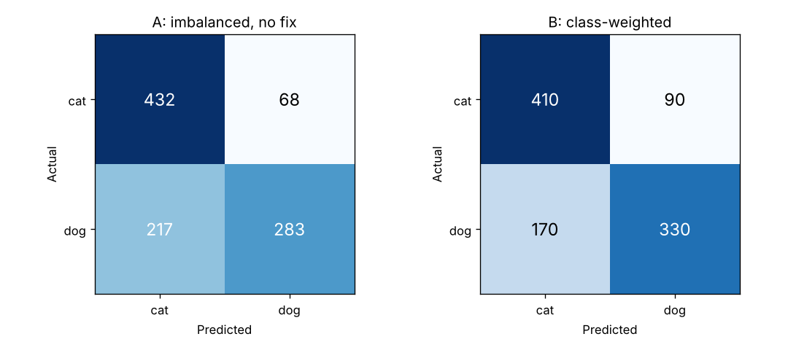

# Task 1 — CNN from Scratch: Cats vs. Dogs, with Class-Imbalance Handling

A convolutional neural network built and trained **from scratch** (no pre-trained weights) in TensorFlow/Keras.
I trained it on a deliberately **imbalanced** dataset (4 cats : 1 dog), then retrained it with **class weights** to measure how much handling the imbalance helps.

**Notebook:** [`cnn_cats_vs_dogs.ipynb`](cnn_cats_vs_dogs.ipynb) · **Data:** `python download_data.py` (4,000 images from Kaggle *Dogs vs. Cats*, ~100 MB)

## Setup
| Split | Cats | Dogs |
|---|---|---|
| Train (imbalanced on purpose) | 1,200 | 300 |
| Validation | 300 | 300 |
| Test | 500 | 500 |

**Architecture:** augmentation (flip/rotate/zoom) → rescale to [0, 1] → 4 × [Conv 3×3 → BatchNorm → ReLU → MaxPool] (32→64→128→128 filters) → GlobalAveragePooling → Dropout → Dense(128) → Dropout → Dense(1, sigmoid). The model has 257k parameters and uses the Adam optimiser, binary cross-entropy loss, early stopping and ReduceLROnPlateau.

## Results (balanced test set)
| Metric | A: no fix | B: class weights |
|---|---|---|
| Accuracy (= balanced accuracy) | 71.5% | **74.0%** |
| Dog recall | 56.6% | **66.0%** |
| Cat recall | **86.4%** | 82.0% |
| Dog F1 | 0.665 | **0.717** |

**Takeaway:** the unweighted model leaned toward the majority class and missed 43% of dogs. Class weighting raised dog recall by 9.4 points and balanced accuracy by 2.5 points, at the cost of slightly lower cat recall. All other settings were identical.
