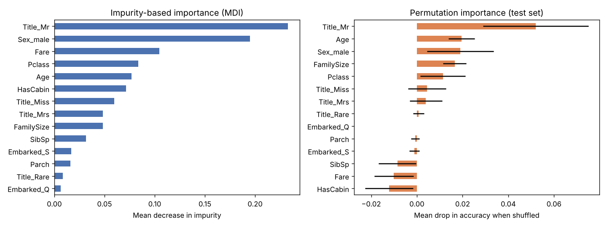

# Task 2 — Random Forest & Feature Importance

Predict Titanic passenger survival with a **Random Forest**, then explain *why* the model predicts what it does.

**Notebook:** [`random_forest_feature_importance.ipynb`](random_forest_feature_importance.ipynb)

## What I did
1. **Inspected the data:** 891 passengers; `Age` is 20% missing and `Cabin` 77% missing. The target is 62% died / 38% survived.
2. **Engineered features:** `Title` (Mr/Mrs/Miss/Master/Rare) extracted from `Name`, `FamilySize`, and `HasCabin`. I dropped ID-like columns.
3. **Split before preprocessing:** I computed the median age and most common port from the training set only, to avoid data leakage.
4. **Compared against baselines:** "always predict died" (62%) and "all women survive" (78–79%).
5. **Trained the Random Forest:** 300 trees, `max_depth=6`, `min_samples_leaf=3` and `class_weight="balanced"`, checked with 5-fold cross-validation.
6. **Interpreted the model** using two methods: impurity-based (MDI) importance and permutation importance on the test set.

## Results
| Metric | Value |
|---|---|
| 5-fold CV accuracy | **0.832 ± 0.034** |
| Test accuracy | **0.804** (gender-rule baseline: 0.777) |
| Test ROC-AUC | **0.841** |
| Survivor recall | 0.80 |
| Train vs. test accuracy | 0.861 vs. 0.804 (no strong overfitting) |

## Key insights
* **Gender is the strongest driver** (`Title_Mr` and `Sex_male`). This matches "women and children first".
* **Age, family size and passenger class** come next.
* **`Fare` looks important under MDI but not under permutation importance.** MDI favours continuous features, and fare is redundant with `Pclass`. That's why I cross-check importance with a second method.
